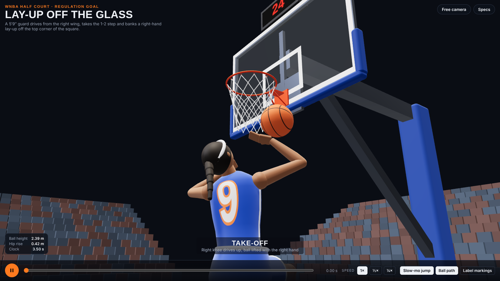

# Lay-Up Off the Glass

A single-file Three.js scene: a 5′9″ (1.75 m) female guard dribbles at the right wing, drives, takes the 1-2 step and banks a right-hand lay-up off the glass into a regulation rim and net.

## Run it

Open `index.html` in a browser (Three.js 0.170 loads from jsDelivr), or serve the folder with any static server, e.g. `npx serve .`.

## What's modelled

- **Court:** WNBA standard (same dimensions as the NBA): 10 ft rim (18 in), 72 × 42 in backboard 4 ft in from the baseline, 24 × 18 in target square, 16 ft lane, free-throw line 15 ft from the board, 6 ft circles, 4 ft restricted area, 22 ft 1¾ in three-point arc (22 ft corners), lane-space marks, 28 ft hash marks, 2 in lines. Size 6 ball.
- **Movement:** procedural IK rig with planted feet and heel roll; left-foot take-off with 0.45 m (18 in) hip rise and 0.63 s air time; release at the top of the jump at 2.64 m.
- **Ball:** solved backwards from the glass contact point (top corner of the square), then simulated with glass restitution, rim check, net drag and floor bounces. The net and ponytail are Verlet simulations.
- **Camera:** cinematic Bezier shots (zoom out, track, swing in to the rim, pull back) with automatic slow motion through the jump. Plays once.

## Controls

Play/pause (Space), timeline scrubber, speed (1×, ½×, ¼×), slow-mo toggle, ball path, marking labels, free orbit camera, and a specs panel.
